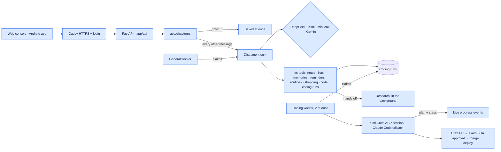

# Architecture

For the target model (work items, disposable chats, tiered agents) see
[`assistant-core-model.md`](assistant-core-model.md).

## How a message is handled

The full picture, with what is built, partial, and next, is
[`personal-assistant-target-architecture.svg`](personal-assistant-target-architecture.svg).
This is the request path in the code today.

- **One decider.** The chat agent, with its tools, is the only thing that decides what a
  message means; it sees the whole conversation. The server does without a model only
  "note: …" and "remember privately …" (which no model may see). The phone app never
  decides: it listens, speaks, and runs the timers, alarms and events a reply proposes as
  a card. (Triage, offers and the phone's on-device router were removed on 2026-10-25:
  most small bugs came from handing messages between deciders.)
- **One Assistant conversation.** The app opens in "Assistant", a permanent conversation
  (`chat_sessions.home`, `GET /chat-sessions/home`) that can't be archived or deleted, with
  the avatar on by default. The agent is told there that it speaks for everything, and in
  every chat it can look across all of them: `overview` (background work, coding runs and
  PRs waiting for review, routines; `app/assistant/everything.py`), `chats` and `chat_read`.
  Results still post in full in the chat that started the work.
- **Workers report to Assistant** (`app/assistant/reporter.py`, run on the scheduler loop).
  - Finished background work (research, routine runs, coding runs: completed, failed or with
    a PR to review) is gathered once nothing new has finished for 30 s, or after 2 minutes at
    most. `tasks.reported_at` marks what was queued for reporting.
  - Reports, retries, reminders and routine starts have durable rows in `outbox_deliveries`.
    The scheduler advances a schedule and enqueues its occurrence in one transaction;
    `app/delivery.py` retries failed delivery with externally keyed tasks and deterministic
    reminder-message IDs preventing duplicates after a crash.
  - A worker claims due rows (`FOR UPDATE SKIP LOCKED`, then hides them for a 5-minute
    lease), so two workers never deliver the same row. A failing row is retried with
    backoff and dropped after 16 attempts; a reminder or alarm push still failing 30
    minutes after it fired is skipped, and cancelling a schedule drops its undelivered
    rows. Schedule details are read from the schedule at delivery time.
  - It becomes one report in Assistant, written by the chat agent in a few lines, with links
    to each result.
  - It pushes to the phone only for the must-knows (a PR to review, a failure, a watch that
    triggered) or when the agent marks the report notable.
  - If no model can write it, a plain list is posted instead. Deployments keep their own push.
  - It follows up on its own:
    - a failed research or routine run is tried once more after a minute, and only a second
      failure is reported;
    - work still queued after 15 minutes, or with no progress for 20 (coding: 45), is raised
      once, with a push;
    - a PR waiting for review gets one quiet reminder a day (`tasks.followed_up_at`).
  - When the agent promises to check something later, it sets a one-off routine then.
- **Recent days.** A rolling summary across all chats (`app/work/digest.py`, table
  `digests`): rewritten by a model call once the chats have been quiet for 10 minutes,
  built from chat messages only (never Notes or private memories), and given to every
  reply. It's shown read-only on the Memories page (`GET /digest`).
- **Speaking from the first sentence.** DeepSeek and Kimi stream their reply
  (`stream_within` in `app/integrations/chat.py`). `ReplyDraft` (`app/execution/draft.py`)
  pulls the reply out of the streaming JSON and records each finished sentence as a `draft`
  progress event (`TaskResponse.draft`).
  - The page shows the draft as it's written.
  - In a spoken conversation it sends each new sentence to the phone as `speak_more`
    (queued); the final reply adds only the sentences not yet said.
  - Phone apps without `speakQueue` wait for the whole reply as before.
- **Coding runs** are started, inspected, steered and stopped through the agent's coding
  tools. No tool can merge or deploy; those stay behind the approval token in the console.
- **The reply agent knows the repositories.** Every chat reply is told which repositories
  are registered and what the assistant can really do, and, for the repository selected in
  the console or named in the message, the start of its README and its top-level files, read
  from GitHub and cached for 15 minutes (`app/repositories/briefs.py`). Before this it knew
  nothing about them and asked the user to paste the README.
- **The reply agent has tools** (`app/assistant/toolbox.py`, `app/assistant/tools.py`). Each
  belongs to an ability in `abilities/`, and is offered only when that ability is available
  on the server:
  - bookkeeping (`app/chat/direct_actions.py`): `remember`, `forget`,
    `list_add`, `list_create`, `list_check`, `work_items`, `note_add` (it can save notes,
    never read them),
    `remind`, and `routine_create`, `routines`, `routine_run`, `routine_stop`;
  - code, read-only and for registered repositories only (with a GitHub token):
    `repo_files`, `repo_read` (200 numbered lines at a time) and `repo_search`;
  - shopping, read-only, from `toolsets/groceries.yaml`: `klarna_spending`,
    `klarna_purchases`, `klarna_upload_export`, and the Willys and Lidl tools when the MCP
    gateway is set (their schemas are asked for when first needed). A chart a tool builds
    and an upload button it asks for go with the reply;
  - a hand-off that runs in the background and posts its answer in the chat: `research`
    (with a search key);
  - coding runs (`SupervisorTools` in `app/assistant/supervisor.py`): `coding_status`, `coding_run`,
    `coding_start` (ends in a draft PR you review), `coding_message` and `coding_stop`.

  The tools go to the model through the provider's own tool calling (Kimi, MiniMax,
  DeepSeek and Gemini all take the OpenAI format); calls a model still writes as text run
  too. It may make up to 6 calls before answering, never the same call twice, and each one
  shows on the reply's card ("Reading app/chat/turns.py"). Results are wrapped as data,
  never instructions; a refused action comes back as "not done", so it can't claim it.
- **Replies carry blocks.** These are choices, links, workflow and work-item cards,
  rendered by pre-built console components. A choice is answered by clicking it or by
  saying "yes" or "no".
- **Coding agents** run as live sessions (Kimi Code over ACP), so their plan and steps
  stream back as progress, and new instructions reach them while they work.

## Code map

| Package | What lives there |
|---|---|
| `app/api` | One router per resource (chat, tasks, workflows, catalog, web, …) and shared helpers |
| `app/chat` | Message handling: the note rule, reply blocks (choices are suggestions), bookkeeping actions, routines |
| `app/assistant` | The chat agent's toolbox and tools, and the overview of coding runs |
| `app/coding` | Starting runs, the agents (runners, ACP sessions, one-shot processes), git, reports, the PR executor |
| `app/services` | `TaskService`: chat, tasks, executions, approvals and progress over one database |
| `app/work` | Work items, briefs, spaces, memory |
| `app/execution` | The chat model and research agent executors |
| `app/worker` | `loop`: claim a task, pick its executor, run it; `jobs`: the general worker's background jobs (schedules, reports, deliveries, deployments, PR sync, model jobs), each a `PeriodicJob` on its own thread; `build`: wiring from settings |
| `app/workflows`, `app/deployments` | Controlled workflows and deployment targets |
| `app/web` | The console: `index.html` plus `static/` CSS and scripts, PWA files |
| `android-assistant/shell` | The Android app: the console in a native shell |

## Rules that hold everywhere

The manager returns only schema-validated actions. Application code owns state
transitions, adapter availability, cancellation and validation. Chat models are used
through one provider-neutral fallback chain: Kimi and MiniMax.

Gemini is used only for text-to-speech, and only the API process receives
`GEMINI_TTS_API_KEY`.

The coding workflow is a registered agent capability, while merging is deliberately
outside routing.
- **Reliable task ownership:** every claim has a unique token. Planning, execution,
  progress, validation, approval and completion writes from a worker are accepted only
  while that claim and its lease remain current, so a stale worker cannot overwrite a
  replacement. Queue scans use keyset batches rather than stopping at the first 100 rows.
- **Independent streaming attempts:** each conversation provider gets a fresh `ReplyDraft`;
  a failed provider's partial text or emitted sentences never leak into the fallback reply.
- **Bounded chat reads:** the API returns the newest 500 messages by default. Stable
  `(created_at, id)` cursors load earlier pages without duplicating messages when new ones
  arrive, and the console offers "Load earlier" for that history.
- **Coding-worker isolation:** a coding-only worker neither starts general assistant jobs
  nor reads transcripts, memories, notes or work-item context. Its dedicated PostgreSQL
  role sees only coding tasks and their execution records; a controlled function is its
  only route to post an assistant reply in the originating chat. Container networking and
  filesystem permissions apply the same boundary.
- **Worker liveness:** every worker lane writes a heartbeat tied to its container instance.
  Compose health checks reject stale, stopped or previous-instance heartbeats (the main and
  reply loops always; extra coding loops once they have started); deployment
  promotion requires the API, public HTTPS and all enabled workers to be healthy.
- **How coding starts:** coding tasks are created only by a coding run, which you start
  in chat or the supervisor starts, or by a PR revision. The public task routes refuse
  coding capabilities.
- **What a coding task does:** it works on its own branch, publishes a draft PR, and
  waits for approval.
- **Merging:** the approval API binds consent to the recorded PR and its exact head SHA
  before calling GitHub. GitHub branch protections remain an independent final gate.

## Picking the executor

A task names the capabilities it needs (`required_capabilities`: none for a chat reply,
`web_research`, or `coding` and `pull_request_creation`). `adapter_for` in
`app/execution/routing.py` picks the first installed executor that provides all of them, from
a short table in code. No model takes part in this. (The manager and the `capabilities/`
manifests it read were removed on 2026-10-30; only their adapter and "provides" lists were
ever used.)
