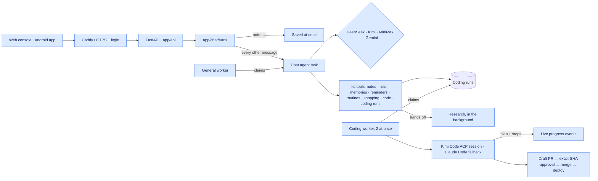

# Architecture

For the target model (work items, disposable chats, tiered agents) see
[`assistant-core-model.md`](assistant-core-model.md).

## How a message is handled

The full picture, with what is built, partial, and next, is
[`personal-assistant-target-architecture.svg`](personal-assistant-target-architecture.svg).
This is the request path in the code today.

- **One decider.** The chat agent, with its tools, is the only thing that decides what a
  message means; it sees the whole conversation. The server does without a model only
  "note: …" and "remember privately …" (which no model may see). The phone app never
  decides: it listens, speaks, and runs the timers, alarms and events a reply proposes as
  a card. (Triage, offers and the phone's on-device router were removed on 2026-10-25:
  most small bugs came from handing messages between deciders.)
- **Coding runs** are started, inspected, steered and stopped through the agent's coding
  tools. No tool can merge or deploy; those stay behind the approval token in the console.
- **The reply agent knows the repositories.** Every chat reply is told which repositories
  are registered and what the assistant can really do, and, for the repository selected in
  the console or named in the message, the start of its README and its top-level files, read
  from GitHub and cached for 15 minutes (`app/repositories/briefs.py`). Before this it knew
  nothing about them and asked the user to paste the README.
- **The reply agent has tools** (`app/assistant/toolbox.py`, `app/assistant/tools.py`). Each
  belongs to an ability in `abilities/`, and is offered only when that ability is available
  on the server:
  - bookkeeping (`app/chat/direct_actions.py`): `remember`, `forget`,
    `list_add`, `list_create`, `list_check`, `work_items`, `note_add` (it can save notes,
    never read them),
    `remind`, and `routine_create`, `routines`, `routine_run`, `routine_stop`;
  - code, read-only and for registered repositories only (with a GitHub token):
    `repo_files`, `repo_read` (200 numbered lines at a time) and `repo_search`;
  - shopping, read-only, from `toolsets/groceries.yaml`: `klarna_spending`,
    `klarna_purchases`, `klarna_upload_export`, and the Willys and Lidl tools when the MCP
    gateway is set (their schemas are asked for when first needed). A chart a tool builds
    and an upload button it asks for go with the reply;
  - a hand-off that runs in the background and posts its answer in the chat: `research`
    (with a search key);
  - coding runs (`SupervisorTools` in `app/assistant/supervisor.py`): `coding_status`, `coding_run`,
    `coding_start` (ends in a draft PR you review), `coding_message` and `coding_stop`.

  The tools go to the model through the provider's own tool calling (Kimi, MiniMax,
  DeepSeek and Gemini all take the OpenAI format); calls a model still writes as text run
  too. It may make up to 6 calls before answering, never the same call twice, and each one
  shows on the reply's card ("Reading app/chat/turns.py"). Results are wrapped as data,
  never instructions; a refused action comes back as "not done", so it can't claim it.
- **Replies carry blocks.** These are choices, links, workflow and work-item cards,
  rendered by pre-built console components. A choice is answered by clicking it or by
  saying "yes" or "no".
- **Coding agents** run as live sessions (Kimi Code over ACP), so their plan and steps
  stream back as progress, and new instructions reach them while they work.

## Code map

| Package | What lives there |
|---|---|
| `app/api` | One router per resource (chat, tasks, workflows, catalog, web, …) and shared helpers |
| `app/chat` | Message handling: the note rule, reply blocks (choices are suggestions), bookkeeping actions, routines |
| `app/assistant` | The chat agent's toolbox and tools, and the overview of coding runs |
| `app/coding` | Starting runs, the agents (runners, ACP sessions, one-shot processes), git, reports, the PR executor |
| `app/services` | `TaskService`: chat, tasks, executions, approvals and progress over one database |
| `app/work` | Work items, briefs, spaces, memory |
| `app/execution` | The chat model and research agent executors |
| `app/workflows`, `app/deployments` | Controlled workflows and deployment targets |
| `app/web` | The console: `index.html` plus `static/` CSS and scripts, PWA files |
| `android-assistant/shell` | The Android app: the console in a native shell |

## Rules that hold everywhere

The manager returns only schema-validated actions. Application code owns state
transitions, adapter availability, cancellation and validation. Chat models are used
through one provider-neutral fallback chain: Kimi and MiniMax.

Gemini is used only for text-to-speech, and only the API process receives
`GEMINI_TTS_API_KEY`.

The coding workflow is a registered agent capability, while merging is deliberately
outside routing.
- **How coding starts:** coding tasks are created only by a coding run, which you start
  in chat or the supervisor starts, or by a PR revision. The public task routes refuse
  coding capabilities.
- **What a coding task does:** it works on its own branch, publishes a draft PR, and
  waits for approval.
- **Merging:** the approval API binds consent to the recorded PR and its exact head SHA
  before calling GitHub. GitHub branch protections remain an independent final gate.

## Picking the executor

A task names the capabilities it needs (`required_capabilities`: none for a chat reply,
`web_research`, or `coding` and `pull_request_creation`). `DeterministicManager` picks the
enabled capability in `capabilities/` that provides them, and the worker runs its adapter.
No model takes part in this. (A model-assisted manager existed behind a setting that was
never turned on; it was removed on 2026-10-25.)
